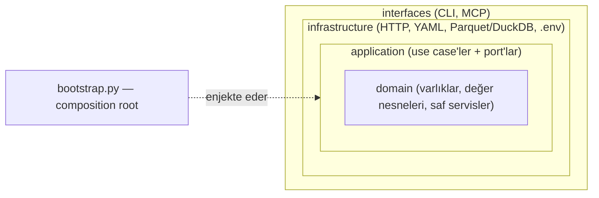

# ML Booster Map

Türkiye için ücretsiz veri kaynaklarını sektör bazında haritalayan ve ML'e hazır **aylık panel** (Parquet) üreten Python aracı. Hem CLI hem de **MCP sunucusu** olarak çalışır; Claude Code / Claude Desktop'a ekleyip doğal dille kullanabilirsiniz.

> **Durum (v0.2):** Katalog 10 kaynak ve 5 sektör içeriyor. Uçtan uca çalışan sağlayıcı şimdilik **TCMB EVDS3**. TÜİK, BDDK, TBB, EPİAŞ, EPDK, BTK, TSB, ODMD ve BKM katalogda yer alıyor; bu kaynakların sağlayıcıları yol haritasında.

## Kurulum

Python 3.12+ gerekir.

```bash
pip install "git+https://github.com/vykarakaya26/ml_booster_mcp.git"
```

EVDS API anahtarınızı alın: [evds3.tcmb.gov.tr](https://evds3.tcmb.gov.tr) → Benim Sayfam → Profilim → **API KEY KOPYALA**. Anahtarı ortam değişkeni ya da `.env` dosyası olarak verin. `.env` çalışma dizininde veya `~/.mlbooster/.env` konumunda olabilir:

```bash
export EVDS_API_KEY=...
```

Anahtar yalnızca HTTP header'ında gönderilir. URL'lere, loglara ve ham veri manifestine yazılmaz.

## Claude Code'da MCP olarak kullanım

```bash
claude mcp add mlbooster -e EVDS_API_KEY=ANAHTARINIZ -- mlbooster-mcp
```

Araçlar: `list_sectors`, `list_sources`, `show_map`, `discover_series`, `fetch_series`, `build_panel`, `health`.

Örnek istemler:
- "Sigorta sektörü için veri kaynağı haritasını göster."
- "bie_dkdovizgn veri grubundaki serileri listele."
- "Otomotiv için 2015'ten bugüne aylık feature panelini üret."

Seri kodlarını keşfetmek için TCMB'nin resmi EVDS-MCP sunucusu da eklenebilir:
`claude mcp add --transport http evds https://mcp.tcmb.gov.tr/tcmb-mcp/evds/mcp`

## CLI

```bash
mlbooster catalog list --sector bankacilik
mlbooster map show --sector sigorta              # --format json
mlbooster catalog series --datagroup bie_dkdovizgn
mlbooster fetch --series TP.TUKFIY2025.GENEL --start 2015-01 --formula 3
mlbooster build-panel --sector otomotiv --out otomotiv.parquet
mlbooster health
```

Veriler varsayılan olarak `~/.mlbooster/data` altında tutulur. Bu dizin `MLBOOSTER_DATA_DIR` ile değiştirilebilir:

| Katman | İçerik |
|---|---|
| `bronze/<kaynak>/` | Ham yanıtlar (sha256 adlı) + `manifest.jsonl` (çekim zamanı, URL) |
| `silver/source_id=<kaynak>/` | Uzun format, her çekim ayrı vintage. Okumada `as_of` öncesi en son vintage seçilir |
| `gold/<sektör>.parquet` | Aylık dönem sonu, hizalanmış feature paneli |

## Panel kuralları

- **Nokta-zamanlı hizalama:** Her gözlem, `dönem sonu + publication_lag_days` tarihinin düştüğü ayın satırına yazılır. Böylece panelde look-ahead sızıntısı olmaz. Örneğin Eylül TÜFE'si Ekim satırında görünür.
- **Frekans dönüşümü:** Günlükten aylığa geçerken seviye serilerinde `avg` (veya `last`), akım serilerinde `sum` kullanılır; tamamlanmamış son ay atılır. Çeyreklik ve yıllık seriler yalnızca ileriye doldurulur.
- **Reel dönüşüm:** Deflatör, TÜFE'nin aylık % değişimlerinden zincirlenerek kurulur. Bu yüzden 2003=100 → 2025=100 baz değişikliği seviyede kırılma yaratmaz.

## Yeni sektör veya seri eklemek

Kod değişikliği gerekmez:
- Sektörler: `src/mlbooster/catalog_data/sectors/*.yaml`
- Kaynaklar ve tohum seriler: `src/mlbooster/catalog_data/sources/*.yaml`

Seri kodu henüz bilinmeyen feature'lar `discover_hint` ile tutulur ve panelde "atlandı" olarak raporlanır. Kendi kataloğunuzu kullanmak için `MLBOOSTER_CATALOG_DIR` değişkenini ayarlayın.

## Mimari: Onion (Application Core)

Kod, bağımlılıkların yalnızca **dıştan içe** aktığı halkalara ayrılmıştır. Çekirdek (domain + application) hiçbir G/Ç kütüphanesini bilmez. HTTP, dosya, veritabanı ve MCP en dış halkada, port'ların arkasında durur.



| Halka | Paket | Sorumluluk | Bağımlı olabileceği |
|---|---|---|---|
| Domain | `mlbooster.domain` | `Source`, `Sector`, `Frequency`, `DateRange`; frekans hizalama, chain-link deflatör, feature dönüşümleri, girdi doğrulama | yalnızca stdlib + pandas/numpy |
| Application | `mlbooster.application` | Use case'ler (`BuildPanel`, `FetchSeries`, `GetSectorMap`, ...) ve port'lar (`SeriesProvider`, `ObservationStore`, `CatalogRepository`, ...) | domain |
| Infrastructure | `mlbooster.infrastructure` | Port uygulamaları: `Evds3Provider`, `SecureHttpClient`, `YamlCatalogRepository`, `ParquetObservationStore` | application, domain |
| Interfaces | `mlbooster.interfaces` | typer CLI, MCP sunucusu, presenter'lar | application, domain, bootstrap |

- **Bağımlılık kuralı test ediliyor:** [`tests/test_architecture.py`](tests/test_architecture.py) her modülün import'larını AST ile tarar. İçteki bir halka dıştakini ya da çekirdek bir G/Ç kütüphanesini import ederse test kırılır.
- **Use case'ler sahte port'larla test ediliyor:** [`tests/fakes.py`](tests/fakes.py) bellek içi sağlayıcı ve depolar sunar; `BuildPanel` HTTP ya da disk olmadan doğrulanır.
- **Yeni kaynak eklemek** = `SeriesProvider` port'unu uygulayan bir sınıf yazmak, onu `infrastructure/providers/registry.py` içine kaydetmek ve katalog YAML'ında `adapter:` alanını vermek. Çekirdekte değişiklik gerekmez.
- **ADR (pandas domain'de):** Zaman serisi matematiği domain kuralıdır ve pandas burada G/Ç değil hesaplama kütüphanesi olarak kullanılıyor. Bu yüzden domain'de pandas/numpy'ye bilinçli olarak izin verildi; depolama şeması (pyarrow) ise altyapıda kalıyor.

## Güvenlik

Öne çıkan önlemler: anahtar yalnızca header'da gider, sağlayıcı başına host sabitlenir, URL/path enjeksiyonuna karşı izin listesi uygulanır, yönlendirme takip edilmez, yanıt boyutu sınırlanır, SQL sorguları parametreli çalışır, YAML katı şemayla okunur, MCP hata mesajları güvenlidir, CI'da `pip-audit` çalışır. Tehdit modelinin tamamı ve ilgili testler için [SECURITY.md](SECURITY.md) dosyasına bakın.

## Lisans ve veri kullanımı

Bu araç veriyi dağıtmaz; her kullanıcı kendi anahtarıyla kaynaklardan çeker. Verilerin kullanım koşulları kaynak kurumlara aittir:

- **TCMB EVDS:** Veriler kaynak gösterilerek kullanılabilir ve yayımlanabilir. Ticari bir üründe kullanıldığında veri, kullanıcılara/abonelere **ek ücret olarak yansıtılamaz**.
- **TSB, ODMD, BKM, TBB vb.:** Açık veri lisansı yayımlamıyorlar. Ticari kullanım ve yeniden dağıtım öncesinde ilgili kurumun site koşullarını kontrol edin.
- Proxy pazar payları (KAP gelirleri, Google Trends) gerçek pazar payı değildir ve `is_proxy` bayrağıyla ayrı tutulur.

## Geliştirme

```bash
python3.12 -m venv .venv && .venv/bin/pip install -e ".[dev]"
.venv/bin/pytest            # offline testler (respx ile mock'lanmış HTTP)
.venv/bin/pytest -m live    # canlı contract testleri, EVDS_API_KEY gerekir
```

Kaynak bazındaki kurallar ve katkı rehberi için [CLAUDE.md](CLAUDE.md) dosyasına bakın.

Kod [MIT](LICENSE) lisanslıdır; verilerin koşulları yukarıda belirtildiği gibi kaynak kurumlara aittir.
