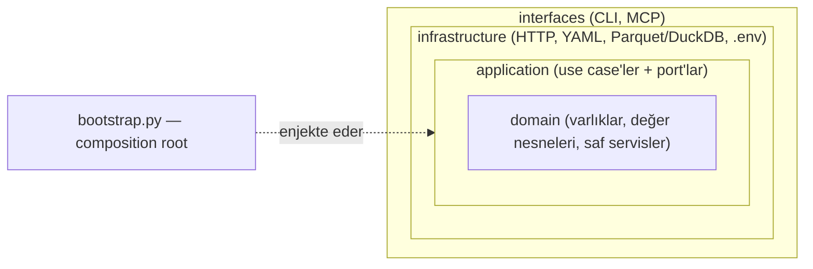

# ML Booster Map

Türkiye için ücretsiz veri kaynaklarını sektör bazında haritalayan ve ML'e hazır **aylık panel** üreten araç. Üç şekilde kullanılabilir:

- **Claude Code plugin'i**: MCP sunucusu ve otonom çalışan 4 skill. Doğal dille "otomotiv sektörünü analiz et" dediğinizde paylaşılabilir bir HTML rapor alırsınız.
- **MCP sunucusu**: Claude Code ya da Claude Desktop'tan araç olarak.
- **CLI / Python paketi**: `mlbooster`.

> **Durum (v0.4):** Katalog 12 kaynak ve 9 sektör içeriyor (bankacılık, sigorta, telekom, otomotiv, akaryakıt, perakende, turizm, konut, makro_genel). Veri çeken sağlayıcılar **TCMB EVDS3**, **BIS** ve **OECD**; hepsi canlı doğrulandı. TÜİK, BDDK, TBB, EPİAŞ, EPDK, BTK, TSB, ODMD ve BKM haritada yer alıyor ama henüz veri çekmiyor; bu kaynakların bağlantıları yol haritasında.

### Veri kapsamı
| Frekans | Seriler (örnekler) | Kaynak |
|---|---|---|
| Günlük (iş günü) | USD/TRY, EUR/TRY, BIST 100, TLREF, AOFM, politika faizi | EVDS, BIS |
| Haftalık | Sektörel kartlı harcamalar (toplam ve 14 sektör: market, giyim, yakıt, konaklama, havayolu, internet…), TCMB rezervleri, M2, kredi ve mevduat faizleri | EVDS |
| Aylık | TÜFE (2025=100), ÜFE, PKA enflasyon beklentisi, sanayi üretimi, kapasite kullanımı, konut fiyat endeksi ve satışları, OSD üretimi, güven endeksleri, BKM kartlı ödeme endeksi, reel/nominal efektif kur, OECD öncü göstergesi ve güven endeksleri | EVDS, BIS, OECD |
| Çeyreklik | Brüt dış borç, konut fiyatları (BIS), özel sektör kredisi/GSYH | EVDS, BIS |

Paneller aylık (varsayılan), haftalık (`--freq W`, Cuma) ya da iş günlük (`--freq B`) üretilebilir. Her frekansta nokta-zamanlı kural geçerlidir.

## 1. EVDS API anahtarı

Anahtarı [evds3.tcmb.gov.tr](https://evds3.tcmb.gov.tr) → Benim Sayfam → Profilim → **API KEY KOPYALA** yolundan alın. Tek bir yere koymanız yeterlidir; CLI, MCP ve skill'lerin hepsi buradan okur:

```bash
mkdir -p ~/.mlbooster && echo "EVDS_API_KEY=ANAHTARINIZ" >> ~/.mlbooster/.env && chmod 600 ~/.mlbooster/.env
```

Anahtar yalnızca HTTP header'ında ve yalnızca `evds3.tcmb.gov.tr` adresine gönderilir. URL'lere, loglara ve ham veri manifestine yazılmaz.

## 2a. Claude Code plugin'i (önerilen)

[uv](https://docs.astral.sh/uv/) gerekir; MCP sunucusu `uvx` ile kendiliğinden kurulur.

```bash
claude plugin install ml-booster --marketplace vykarakaya26/ml_booster_mcp
```

Claude Code içinden de kurulabilir: `/plugin install ml-booster --marketplace vykarakaya26/ml_booster_mcp`

**Kendini güncelleme.** Plugin, `main` dalındaki her merge'i yeni sürüm olarak görür; MCP sunucusu ve skill'ler plugin'in kendi kopyasından çalışır (`uvx --from ${CLAUDE_PLUGIN_ROOT}`). Otomatik güncelleme üçüncü taraf marketplace'lerde varsayılan kapalıdır ve yalnızca kullanıcı açabilir; bir kez açmanız yeterlidir:

1. Claude Code'da `/plugin` → **Marketplaces** → `ml-booster-tools` → **Enable auto-update**.
2. Güncelleme indiğinde Claude Code `Plugin updated: ml-booster · Run /reload-plugins to apply` der. `/reload-plugins` yeni sürümü hemen yükler; yazmazsanız bir sonraki oturumda yüklenir.

Ek olarak:
- `check_updates` MCP aracı ve `mlbooster version --check` yeni sürüm olup olmadığını söyler. Sonuç 24 saat önbellekte tutulur; kontrolü kapatmak için `MLBOOSTER_NO_UPDATE_CHECK=1` kullanın.
- **Veri de kendini yeniler.** Panel kurulurken yerel önbellek serinin frekansına göre tazelik süresini aşmışsa (günlük 12 saat, haftalık 1 gün, aylık 3 gün, çeyreklik 7 gün) veri kaynaktan yeniden çekilir. Her çekim ayrı bir sürüm olarak saklanır, eski sürümler korunur.

| Skill | Ne yapar | Örnek istem |
|---|---|---|
| `sector-analysis` | Kaynak haritası, panel, kalite özeti ve tahmin referanslarını yorumlu bir HTML raporda birleştirir | "Otomotiv sektörü için veri analizi ve rapor hazırla" |
| `evds-series-discovery` | EVDS'de güncel seri kodunu bulur, canlı doğrular ve feature'a bağlar | "Bankacılıkta kredi faizi feature'ı eksik, EVDS'den bul" |
| `data-quality-audit` | Bayat seri, eksik, aykırı değer, yapısal kırılma ve kolineerlik denetimi yapar (HTML) | "Sigorta panelindeki veriler temiz mi?" |
| `forecast-baseline` | Look-ahead korumalı backtest yapar. Karşılaştırılan modeller:<br>• çapa/naive, drift ve son dönem eğimi<br>• son 12 ay ortalaması ve medyanı<br>• ridge<br>• kantil regresyon (%10–%90 aralık)<br>• ortalama/medyan kombinasyonları (sapma yüksekse medyana geçen otomatik kural dahil)<br>Ölçütler: aralık kapsaması ve pinball kaybı. Kurumların yıl sonu tahminlerinin konsensüsünü yanına koyar (fan chart'lı HTML) | "Dolar/TL için yenmemiz gereken çıta ne, bankalar yıl sonu ne diyor?" |

Raporlar çalışma dizininde `mlbooster-reports/<sektör>-<tarih>/` altına yazılır. Raporlar tek dosyadır, açık/koyu temayı destekler ve dış kaynak yüklemez.

### Varsayım ve dayanak yapısı
Analiz içeren skill'ler işe başlamadan önce kullanıcıdan şu girdileri alır:
- amaç ve desteklenen karar
- hedef değişken
- ufuk
- nominal ya da reel çalışılacağı
- sektör varsayımları

Bu girdiler `assumptions.json` dosyasına kaydedilir. Raporun **Girdiler ve varsayımlar** bölümü her varsayımın türünü (kullanıcı onaylı, sektör varsayımı, onaysız varsayılan ya da veriden), güven düzeyini ve tarihini gösterir. 3 aydan eski bilgiler "bayat — doğrula" diye işaretlenir. Rapordaki her ifade dört dayanaktan birine bağlıdır: **veri**, **varsayım (A#)**, **model** ya da **yorum**. Onaysız bir varsayıma dayanan sonuç koşullu yazılır.

### Know-how belgeleri (`skills/_shared/references/`)

| Belge | İçerik |
|---|---|
| `analysis-playbook.md` | Dağılım teşhisi (ADF ve KPSS birlikte, kalın kuyruk, oynaklık rejimi, mevsimsellik); yüksek enflasyona özgü kurallar (log-fark, YoY baz etkisi, reel faiz, efektif politika duruşu, olay takvimi); sızıntı kontrol listesi; rolling-origin değerlendirme ve çıtalar |
| `assumptions-guide.md` | Analiz öncesi sorulacak sorular, varsayım kaydı, veri/varsayım/model/yorum etiketleri, senaryo ve duyarlılık, ölçülü olasılık dili, abartıya karşı kontrol listesi |
| `sector-assumptions.md` | Bankacılık, sigorta, telekom, otomotiv ve akaryakıt için belirleyiciler, açıkça yazılması gereken varsayımlar ve birincil kontrol kaynakları. Regülasyon rakamları sabit olarak gömülmez |

## 2b. Yalnızca MCP sunucusu

```bash
pip install "git+https://github.com/vykarakaya26/ml_booster_mcp.git"
claude mcp add mlbooster -- mlbooster-mcp
```

Araçlar: `list_sectors`, `list_sources`, `show_map`, `search_series`, `discover_series`, `set_feature_series`, `fetch_series`, `build_panel`, `audit_panel`, `run_backtest`, `health`.

Seri kodlarını keşfetmek için TCMB'nin resmi EVDS-MCP sunucusu da eklenebilir:
`claude mcp add --transport http evds https://mcp.tcmb.gov.tr/tcmb-mcp/evds/mcp`

## CLI

```bash
mlbooster catalog list --sector bankacilik
mlbooster map show --sector sigorta                       # --format json
mlbooster catalog search "kredi faiz"                     # EVDS veri grubu arama
mlbooster catalog series --datagroup bie_kt100h
mlbooster catalog set-feature --sector otomotiv --feature tasit_kredisi_faizi --series TP.KTF11
mlbooster fetch --series TP.TUKFIY2025.GENEL --start 2015-01 --formula 3
mlbooster build-panel --sector otomotiv --out otomotiv.csv  # .parquet veya .csv
mlbooster build-panel --sector makro_genel --freq W --out makro_haftalik.csv  # haftalık (Cuma) panel
mlbooster audit --sector otomotiv --json audit.json
mlbooster backtest --sector bankacilik --target aofm --anchor aofm_son --json bt.json  # kantil/kombinasyon dahil
mlbooster health
```

Veriler varsayılan olarak `~/.mlbooster/data` altında tutulur. Bu dizin `MLBOOSTER_DATA_DIR` ile değiştirilebilir:

| Katman | İçerik |
|---|---|
| `bronze/<kaynak>/` | Ham yanıtlar (sha256 adlı) + `manifest.jsonl` (çekim zamanı, URL) |
| `silver/source_id=<kaynak>/` | Uzun format, her çekim ayrı vintage. Okumada `as_of` öncesi en son vintage seçilir |
| `gold/<sektör>.parquet` | Aylık dönem sonu, hizalanmış feature paneli |

## Panel kuralları

- **Nokta-zamanlı hizalama:** Paneldeki tarih, verinin referans ayını değil **kullanılabilir hale geldiği ayı** gösterir. Böylece look-ahead sızıntısı olmaz. Örneğin Eylül TÜFE'si (3 Ekim'de yayımlanır) Ekim satırındadır. Hedef değişkeni panelle birleştirirken bu kuralı göz önünde bulundurun.
  - Günlük ve haftalık serilerde gecikme her gözleme aylığa toplamadan önce uygulanır, yani t satırı t içinde yayımlanan gözlemlerin ortalamasıdır.
  - Aylık ve çeyreklik serilerde sabit bir ay kayması uygulanır; hiçbir ay kaybolmaz ve çakışmaz.
- **Frekans dönüşümü:** Günlükten aylığa geçerken seviye serilerinde `avg` (veya `last`), akım serilerinde `sum` kullanılır; tamamlanmamış son ay atılır. Çeyreklik ve yıllık seriler yalnızca ileriye doldurulur.
- **Reel dönüşüm:** Deflatör, TÜFE'nin aylık % değişimlerinden zincirlenerek kurulur. Bu yüzden 2003=100 → 2025=100 baz değişikliği seviyede kırılma yaratmaz.

## Yeni sektör veya seri eklemek

- **Kendi makinenizde**: `mlbooster catalog set-feature` komutu (ya da `evds-series-discovery` skill'i) kodu canlı doğrular ve `~/.mlbooster/catalog/overrides.yaml` dosyasına yazar. Paket dosyaları değişmez.
- **Herkes için (PR)**: `src/mlbooster/catalog_data/sectors/*.yaml` ve `sources/*.yaml` dosyalarını düzenleyin. Kod değişikliği gerekmez.

Seri kodu henüz bilinmeyen feature'lar `discover_hint` ile tutulur ve panelde "atlandı" olarak raporlanır.

## Mimari: Onion (Application Core)

Kod, bağımlılıkların yalnızca **dıştan içe** aktığı halkalara ayrılmıştır. Çekirdek (domain + application) hiçbir G/Ç kütüphanesini bilmez. HTTP, dosya, veritabanı ve MCP en dış halkada, port'ların arkasında durur.



| Halka | Paket | Sorumluluk | Bağımlı olabileceği |
|---|---|---|---|
| Domain | `mlbooster.domain` | `Source`, `Sector`, `Frequency`, `DateRange`; frekans hizalama, chain-link deflatör, feature dönüşümleri, girdi doğrulama | yalnızca stdlib + pandas/numpy |
| Application | `mlbooster.application` | Use case'ler (`BuildPanel`, `FetchSeries`, `GetSectorMap`, ...) ve port'lar (`SeriesProvider`, `ObservationStore`, `CatalogRepository`, ...) | domain |
| Infrastructure | `mlbooster.infrastructure` | Port uygulamaları: `Evds3Provider`, `SecureHttpClient`, `YamlCatalogRepository`, `ParquetObservationStore` | application, domain |
| Interfaces | `mlbooster.interfaces` | typer CLI, MCP sunucusu, presenter'lar | application, domain, bootstrap |

- **Bağımlılık kuralı test ediliyor:** [`tests/test_architecture.py`](tests/test_architecture.py) her modülün import'larını AST ile tarar. İçteki bir halka dıştakini ya da çekirdek bir G/Ç kütüphanesini import ederse test kırılır.
- **Use case'ler sahte port'larla test ediliyor:** [`tests/fakes.py`](tests/fakes.py) bellek içi sağlayıcı ve depolar sunar; `BuildPanel` HTTP ya da disk olmadan doğrulanır.
- **Yeni kaynak eklemek** = `SeriesProvider` port'unu uygulayan bir sınıf yazmak, onu `infrastructure/providers/registry.py` içine kaydetmek ve katalog YAML'ında `adapter:` alanını vermek. Çekirdekte değişiklik gerekmez.
- **ADR (pandas domain'de):** Zaman serisi matematiği domain kuralıdır ve pandas burada G/Ç değil hesaplama kütüphanesi olarak kullanılıyor. Bu yüzden domain'de pandas/numpy'ye bilinçli olarak izin verildi; depolama şeması (pyarrow) ise altyapıda kalıyor.

## Güvenlik

Öne çıkan önlemler: anahtar yalnızca header'da gider, sağlayıcı başına host sabitlenir, URL/path enjeksiyonuna karşı izin listesi uygulanır, yönlendirme takip edilmez, yanıt boyutu sınırlanır, SQL sorguları parametreli çalışır, YAML katı şemayla okunur, MCP hata mesajları güvenlidir, CI'da `pip-audit` çalışır. Tehdit modelinin tamamı ve ilgili testler için [SECURITY.md](SECURITY.md) dosyasına bakın.

## Lisans ve veri kullanımı

Bu araç veriyi dağıtmaz; her kullanıcı kendi anahtarıyla kaynaklardan çeker. Verilerin kullanım koşulları kaynak kurumlara aittir:

- **TCMB EVDS:** Veriler kaynak gösterilerek kullanılabilir ve yayımlanabilir. Ticari bir üründe kullanıldığında veri, kullanıcılara/abonelere **ek ücret olarak yansıtılamaz**.
- **TSB, ODMD, BKM, TBB vb.:** Açık veri lisansı yayımlamıyorlar. Ticari kullanım ve yeniden dağıtım öncesinde ilgili kurumun site koşullarını kontrol edin.
- Proxy pazar payları (KAP gelirleri, Google Trends) gerçek pazar payı değildir ve `is_proxy` bayrağıyla ayrı tutulur.

## Geliştirme

```bash
python3.12 -m venv .venv && .venv/bin/pip install -e ".[dev]"
.venv/bin/pytest            # offline testler (respx ile mock'lanmış HTTP)
.venv/bin/pytest -m live    # canlı contract testleri, EVDS_API_KEY gerekir
```

Kaynak bazındaki kurallar ve katkı rehberi için [CLAUDE.md](CLAUDE.md) dosyasına bakın.

Kod [MIT](LICENSE) lisanslıdır; verilerin koşulları yukarıda belirtildiği gibi kaynak kurumlara aittir.
