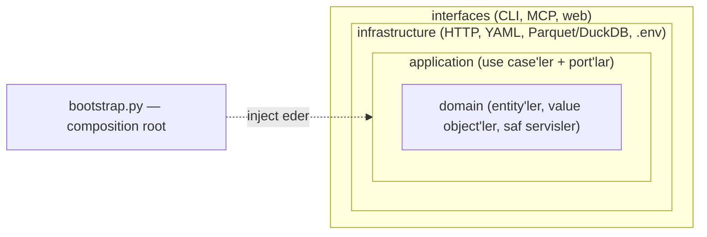

# ML Booster Map

Türkiye için ücretsiz veri kaynaklarını sektör bazında haritalayan ve ML'e hazır **aylık panel** üreten araç. Üç şekilde kullanılabilir:

- **Claude Code plugin'i**: MCP sunucusu ve uçtan uca birlikte çalışan 7 skill. "Otomotiv sektörünü analiz et" gibi doğal dildeki bir istek, paylaşılabilir bir HTML rapor üretir.
- **MCP sunucusu**: Claude Code ya da Claude Desktop'tan araç olarak.
- **CLI / Python paketi**: `mlbooster`.
- **Yerel web paneli**: `mlbooster web`. Sektörü, tarih aralığını, hedef seriyi ve modelleri tarayıcıdan seçersiniz; yalnızca bu bilgisayarda (127.0.0.1) çalışır.

> **Durum:** Katalog 12 kaynak ve 9 sektör içeriyor (bankacılık, sigorta, telekom, otomotiv, akaryakıt, perakende, turizm, konut, makro_genel). Veri çeken provider'lar **TCMB EVDS3**, **BIS** ve **OECD**; üçü de canlı doğrulandı. TÜİK, BDDK, TBB, EPİAŞ, EPDK, BTK, TSB, ODMD ve BKM haritada yer alıyor ancak henüz veri çekmiyor; bu kaynakların adapter'ları yol haritasında.

### Veri kapsamı
| Frekans | Seriler (örnekler) | Kaynak |
|---|---|---|
| Günlük (iş günü) | USD/TRY, EUR/TRY, BIST 100, TLREF, AOFM, politika faizi | EVDS, BIS |
| Haftalık | Sektörel kartlı harcamalar (toplam ve 14 sektör: market, giyim, yakıt, konaklama, havayolu, internet…), TCMB rezervleri, M2, kredi ve mevduat faizleri | EVDS |
| Aylık | TÜFE (2025=100), ÜFE, PKA enflasyon beklentisi, sanayi üretimi, kapasite kullanımı, konut fiyat endeksi ve satışları, OSD üretimi, güven endeksleri, BKM kartlı ödeme endeksi, reel/nominal efektif kur, OECD öncü göstergesi ve güven endeksleri | EVDS, BIS, OECD |
| Çeyreklik | Brüt dış borç, konut fiyatları (BIS), özel sektör kredisi/GSYH | EVDS, BIS |

Paneller aylık (varsayılan), haftalık (`--freq W`, Cuma) ya da iş günü frekansında (`--freq B`) üretilebilir. Her frekansta point-in-time kuralı geçerlidir.

## 1. EVDS API key

API key'i [evds3.tcmb.gov.tr](https://evds3.tcmb.gov.tr) → Benim Sayfam → Profilim → **API KEY KOPYALA** yolundan alın. Tek bir yere koymanız yeterlidir; CLI, MCP sunucusu ve bütün skill'ler buradan okur:

```bash
mkdir -p ~/.mlbooster && echo "EVDS_API_KEY=ANAHTARINIZ" >> ~/.mlbooster/.env && chmod 600 ~/.mlbooster/.env
```

Key yalnızca HTTP header'ında ve yalnızca `evds3.tcmb.gov.tr` adresine gönderilir. URL'lere, log'lara ve ham veri manifest'ine yazılmaz.

## 2a. Claude Code plugin'i (önerilen)

[uv](https://docs.astral.sh/uv/) gerekir; MCP sunucusu `uvx` ile otomatik kurulur.

```bash
claude plugin install ml-booster --marketplace vykarakaya26/ml_booster_mcp
```

Claude Code içinden de kurulabilir: `/plugin install ml-booster --marketplace vykarakaya26/ml_booster_mcp`

**Otomatik güncelleme.** Plugin, `main` dalındaki her merge'ü yeni sürüm olarak görür; MCP sunucusu ve skill'ler plugin'in kendi kopyasından çalışır (`uvx --from ${CLAUDE_PLUGIN_ROOT}`). Üçüncü taraf marketplace'lerde otomatik güncelleme varsayılan olarak kapalıdır ve yalnızca kullanıcı açabilir; bir kez açmanız yeterlidir:

1. Claude Code'da `/plugin` → **Marketplaces** → `ml-booster-tools` → **Enable auto-update**.
2. Güncelleme indiğinde Claude Code `Plugin updated: ml-booster · Run /reload-plugins to apply` mesajını gösterir. `/reload-plugins` yeni sürümü hemen yükler; komut çalıştırılmazsa yeni sürüm bir sonraki oturumda yüklenir.

Ek olarak:
- `check_updates` MCP aracı ve `mlbooster version --check` komutu yeni sürüm olup olmadığını bildirir. Sonuç 24 saat cache'te tutulur; kontrolü kapatmak için `MLBOOSTER_NO_UPDATE_CHECK=1` kullanın.
- **Veri cache'inin yenilenmesi.** Panel kurulurken yerel cache serinin frekansına göre belirlenen TTL'yi aşmışsa (günlük 12 saat, haftalık 1 gün, aylık 3 gün, çeyreklik 7 gün) veri kaynaktan yeniden çekilir. Her çekim ayrı bir vintage olarak saklanır; eski vintage'lar korunur.

| Skill | Ne yapar | Örnek istem |
|---|---|---|
| `sector-analysis` | Kaynak haritasını, paneli, kalite özetini ve forecast baseline'larını yorumlu bir HTML raporda birleştirir | "Otomotiv sektörü için veri analizi ve rapor hazırla" |
| `evds-series-discovery` | EVDS'de güncel seri kodunu bulur, canlı doğrular ve feature'a bağlar | "Bankacılıkta kredi faizi feature'ı eksik, EVDS'den bul" |
| `data-quality-audit` | Stale seri, eksik gözlem, outlier, structural break ve collinearity denetimi yapar (HTML) | "Sigorta panelindeki verilerin kalitesini denetle" |
| `forecast-baseline` | Look-ahead korumalı backtest yapar. Karşılaştırılan modeller:<br>• anchor/naive, drift ve son dönem eğimi<br>• son 12 ay ortalaması ve medyanı<br>• ridge<br>• quantile regression (%10–%90 aralık)<br>• ortalama/medyan kombinasyonları (sapma yüksekse medyana geçen otomatik kural dahil)<br>Ölçütler: interval coverage ve pinball loss. Kurumların yıl sonu tahminlerinin konsensüsünü karşılaştırma için yanına koyar (fan chart'lı HTML) | "USD/TRY için geçilmesi gereken baseline nedir; kurumların yıl sonu tahminleri ne düzeyde?" |
| `market-share` | Pazar payı ve rekabet analizi: paylar (aylık akımda son 12 ay tabanı), yoğunlaşma (HHI aralığı, CR3/CR5, istikrarsızlık endeksi), oyuncu bazında eğilim, veriye dayalı rakip seti (ikame korelasyonu, segment örtüşmesi) ve nitel rakip değerlendirmesi, shift-share ayrıştırması, pazar büyümesinin makro sürücüleri (HTML). Girdi kolonları `entity, date, value[, segment]`; pazar toplamı `TOPLAM` satırlarıyla verilir (`TOTAL` da kabul edilir) | "Elimdeki ODMD verisiyle Marka X'in pazar payını ve rakiplerini analiz et" |
| `data-prep` | Dağılıma dayalı ön işleme: her feature için eğitim penceresinde ortalama/standart sapma ile medyan/MAD/IQR arasında seçim, nedensel Hampel filtresiyle outlier'ları winsorize etme ya da işaretleme, log/Yeo–Johnson, unit root varsa fark alma, standard/robust scaling; bütün parametreler yalnızca eğitim penceresinden tahmin edilir (HTML) | "Telekom panelini ridge modeline hazırla; medyan mı ortalama mı karar ver" |
| `feature-engineering` | Sektöre özgü otomatik feature üretimi (lag, rolling istatistik, momentum, z-score, reel faiz ve faiz farkı tarifleri, iş günü ve bayram takvimi, ÖTV/eşel mobil/deprem gibi olaylar) ve etkin örneklem + Benjamini–Hochberg ile leakage'sız seçim; katkısı seçim sonrası dönemde backtest ile ölçülür (HTML) | "Enflasyonu 1 ay ileri tahmin etmek için feature üret ve seç" |

Raporlar çalışma dizininde `mlbooster-reports/<sektör>-<tarih>/` altına yazılır. Her rapor tek dosyadır, açık/koyu temayı destekler ve dış kaynak yüklemez.

### Varsayım ve dayanak yapısı
Analiz yapan skill'ler işe başlamadan önce kullanıcıdan şu girdileri alır:
- amaç ve desteklenen karar
- hedef değişken
- ufuk
- nominal ya da reel çalışılacağı
- sektör varsayımları

Bu girdiler `assumptions.json` dosyasına kaydedilir. Raporun **Girdiler ve varsayımlar** bölümü her varsayımın türünü (kullanıcı onaylı, sektör varsayımı, onaysız varsayılan ya da veriden türetilmiş), güven düzeyini ve tarihini gösterir. 3 aydan eski bilgiler "güncel değil — doğrulanmalı" olarak işaretlenir. Rapordaki her ifade dört dayanaktan birine bağlanır: **veri**, **varsayım (A#)**, **model** ya da **yorum**. Onaysız bir varsayıma dayanan sonuç koşullu olarak yazılır.

Skill'ler tek bir analiz zincirinin halkalarıdır; aynı çalışma klasörünü, varsayım kaydını ve eğitim penceresini paylaşır: `sector-analysis` → `data-quality-audit` → `data-prep` → `feature-engineering` → `forecast-baseline`, oyuncu düzeyinde `market-share` (ayrıntı: `skills/_shared/references/workflow.md`; O'Reilly ve serbest erişimli kitaplar dahil kaynakça: `skills/_shared/references/literature.md`).

### Metodoloji belgeleri (`skills/_shared/references/`)

| Belge | İçerik |
|---|---|
| `analysis-playbook.md` | Dağılım teşhisi (ADF ve KPSS birlikte, kalın kuyruk, volatilite rejimi, mevsimsellik); yüksek enflasyona özgü kurallar (log-fark, YoY baz etkisi, reel faiz, efektif politika duruşu, olay takvimi); leakage kontrol listesi; rolling-origin değerlendirme ve baseline'lar |
| `assumptions-guide.md` | Analiz öncesinde sorulacak sorular, varsayım kaydı, veri/varsayım/model/yorum etiketleri, senaryo ve duyarlılık analizi, ölçülü olasılık dili, abartıya karşı kontrol listesi |
| `sector-assumptions.md` | Bankacılık, sigorta, telekom, otomotiv ve akaryakıt için belirleyiciler, açıkça yazılması gereken varsayımlar ve birincil kontrol kaynakları. Regülasyon rakamları sabit olarak gömülmez |

## 2b. Yalnızca MCP sunucusu

```bash
pip install "git+https://github.com/vykarakaya26/ml_booster_mcp.git"
claude mcp add mlbooster -- mlbooster-mcp
```

Araçlar: `list_sectors`, `list_sources`, `show_map`, `search_series`, `discover_series`, `set_feature_series`, `fetch_series`, `build_panel`, `audit_panel`, `run_backtest`, `prepare_panel`, `engineer_features`, `analyze_market_share`, `health`, `check_updates`.

Seri kodlarını keşfetmek için TCMB'nin resmi EVDS-MCP sunucusu da eklenebilir:
`claude mcp add --transport http evds https://mcp.tcmb.gov.tr/tcmb-mcp/evds/mcp`

## CLI

```bash
mlbooster catalog list --sector bankacilik
mlbooster map show --sector sigorta                       # --format json
mlbooster catalog search "kredi faiz"                     # EVDS veri grubu arama
mlbooster catalog series --datagroup bie_kt100h
mlbooster catalog set-feature --sector otomotiv --feature tasit_kredisi_faizi --series TP.KTF11
mlbooster fetch --series TP.TUKFIY2025.GENEL --start 2015-01 --formula 3
mlbooster build-panel --sector otomotiv --out otomotiv.csv  # .parquet veya .csv
mlbooster build-panel --sector makro_genel --freq W --out makro_haftalik.csv  # haftalık (Cuma) panel
mlbooster audit --sector otomotiv --json audit.json
mlbooster backtest --sector bankacilik --target aofm --anchor aofm_son --json bt.json  # quantile ve kombinasyon modelleri dahil
mlbooster prep --sector makro_genel --target tufe_yoy --train-end 2022-12 --out hazir.csv --json prep.json
mlbooster features --sector makro_genel --target tufe_yoy --train-end 2022-12 --selected-out secilen.csv --json features.json
mlbooster backtest --sector makro_genel --target tufe_yoy --panel-file secilen.csv --eval-start 2022-12  # seçim sonrası dönemde ölç
mlbooster market-share --input pay.csv --focus "Marka X" --unit adet --sector otomotiv --json share.json
mlbooster health
mlbooster web                                             # yerel web paneli: http://127.0.0.1:8765
```

### Yerel web paneli

`mlbooster web` komutu tarayıcıda bir panel açar. Panelde şu ekranlar bulunur:

| Ekran | İçerik |
|---|---|
| Sektör haritası | Kaynaklar, makro feature'lar (hazır / keşif bekliyor), pazar payı kaynakları, lisans notları |
| Feature paneli | Frekans seçimi (aylık, haftalık, iş günü), her feature için ayrı grafik, CSV/Parquet indirme |
| Model karşılaştırma | Hedef, çapa, ufuk, asgari eğitim süresi ve model seçimi. Gerçekleşen ve tahmin grafiği (%80 aralıkla), MAE sıralaması, rejimlere göre hata |
| Veri kalitesi | Önem derecesine göre bulgular, aykırı değer ve kırılma işaretli seri grafiği, korelasyon çiftleri |
| Kaynak durumu | Sağlayıcı kanarya testleri |

Panel aynı use case'leri CLI ve MCP ile ortak kullanır. Sunucu yalnızca `127.0.0.1` adresine bağlanır. Port `--port` ile değiştirilir; tarayıcının otomatik açılmasını `--no-open` kapatır.

Veriler varsayılan olarak `~/.mlbooster/data` altında tutulur. Bu dizin `MLBOOSTER_DATA_DIR` ile değiştirilebilir:

| Katman | İçerik |
|---|---|
| `bronze/<kaynak>/` | Ham yanıtlar (sha256 adlı) + `manifest.jsonl` (çekim zamanı, URL) |
| `silver/source_id=<kaynak>/` | Uzun format; her çekim ayrı bir vintage. Okumada her anahtar için en son vintage seçilir; store `as_of` ile geçmiş bir andaki vintage'ı da okuyabilir, ancak CLI ve MCP panel üretimi şu an her zaman en son vintage'ı kullanır |
| `gold/<sektör>.parquet` | Aylık dönem sonuna hizalanmış feature paneli |

## Panel kuralları

- **Point-in-time hizalama:** Paneldeki tarih, verinin referans ayını değil **kullanılabilir hale geldiği ayı** gösterir. Böylece look-ahead leakage oluşmaz. Örneğin Eylül TÜFE'si (3 Ekim'de yayımlanır) Ekim satırındadır. Hedef değişkeni panelle birleştirirken bu kuralı dikkate alın.
  - Günlük ve haftalık serilerde publication lag, aylığa toplamadan önce her gözleme ayrı ayrı uygulanır; yani t satırı, t ayı içinde yayımlanan gözlemlerin ortalamasıdır.
  - Aylık ve çeyreklik serilerde sabit bir ay kayması uygulanır; hiçbir ay kaybolmaz ve çakışmaz.
- **Frekans dönüşümü:** Günlükten aylığa geçerken seviye serilerinde `avg` (veya `last`), akım serilerinde `sum` kullanılır; tamamlanmamış son ay atılır. Çeyreklik ve yıllık seriler yalnızca forward-fill ile doldurulur.
- **Reel dönüşüm:** Deflator, TÜFE'nin aylık yüzde değişimlerinden chain-link ile kurulur. Bu nedenle 2003=100 → 2025=100 baz değişikliği seviyede kırılma yaratmaz.

## Yeni sektör veya seri eklemek

- **Kendi makinenizde**: `mlbooster catalog set-feature` komutu (ya da `evds-series-discovery` skill'i) kodu canlı doğrular ve `~/.mlbooster/catalog/overrides.yaml` dosyasına yazar. Paket dosyaları değişmez.
- **Herkes için (PR)**: `src/mlbooster/catalog_data/sectors/*.yaml` ve `sources/*.yaml` dosyalarını düzenleyin. Kod değişikliği gerekmez.

Seri kodu henüz bilinmeyen feature'lar `discover_hint` ile tutulur ve panelde "atlandı" olarak raporlanır.

## Mimari: Onion (Application Core)

Kod, bağımlılıkların yalnızca **dıştan içe** aktığı halkalara ayrılmıştır. Çekirdek (domain + application) hiçbir G/Ç kütüphanesini bilmez. HTTP, dosya, veritabanı ve MCP en dış halkada, port'ların arkasında durur.



| Halka | Paket | Sorumluluk | Bağımlı olabileceği |
|---|---|---|---|
| Domain | `mlbooster.domain` | `Source`, `Sector`, `Frequency`, `DateRange`; frekans hizalama, chain-link deflator, feature dönüşümleri, girdi doğrulama | yalnızca stdlib + pandas/numpy |
| Application | `mlbooster.application` | Use case'ler (`BuildPanel`, `FetchSeries`, `GetSectorMap`, ...) ve port'lar (`SeriesProvider`, `ObservationStore`, `CatalogRepository`, ...) | domain |
| Infrastructure | `mlbooster.infrastructure` | Port uygulamaları: `Evds3Provider`, `SecureHttpClient`, `YamlCatalogRepository`, `ParquetObservationStore` | application, domain |
| Interfaces | `mlbooster.interfaces` | typer CLI, MCP sunucusu, yerel web paneli (Starlette), presenter'lar | application, domain, bootstrap |

- **Bağımlılık kuralı test ediliyor:** [`tests/test_architecture.py`](tests/test_architecture.py) her modülün import'larını AST ile tarar. İçteki bir halka dıştakini ya da çekirdek bir G/Ç kütüphanesini import ederse test başarısız olur.
- **Use case'ler fake port'larla test ediliyor:** [`tests/fakes.py`](tests/fakes.py) bellek içi provider ve store'lar sunar; `BuildPanel` HTTP ya da disk olmadan doğrulanır.
- **Yeni kaynak eklemek** = `SeriesProvider` port'unu uygulayan bir sınıf yazmak, onu `infrastructure/providers/registry.py` içine kaydetmek ve katalog YAML'ında `adapter:` alanını vermek. Çekirdekte değişiklik gerekmez.
- **ADR (domain'de pandas):** Zaman serisi hesapları domain kuralıdır ve pandas burada G/Ç için değil hesaplama kütüphanesi olarak kullanılır. Bu nedenle domain'de pandas/numpy'ye bilinçli olarak izin verildi; depolama schema'sı (pyarrow) ise infrastructure'da kalır.

## Güvenlik

Öne çıkan önlemler: API key yalnızca header'da gönderilir, host her provider için sabitlenir, URL/path injection'a karşı allow-list uygulanır, yönlendirmeler takip edilmez, yanıt boyutu sınırlanır, SQL sorguları parametreli çalışır, YAML katı bir schema ile okunur, MCP hata mesajları güvenlidir, CI'da `pip-audit` çalışır. Tehdit modelinin tamamı ve ilgili testler için [SECURITY.md](SECURITY.md) dosyasına bakın.

## Lisans ve veri kullanımı

Bu araç veri dağıtmaz; her kullanıcı veriyi kendi API key'iyle kaynaklardan çeker. Verilerin kullanım koşulları kaynak kurumlara aittir:

- **TCMB EVDS:** Veriler kaynak gösterilerek kullanılabilir ve yayımlanabilir. Ticari bir üründe kullanıldığında veri, kullanıcılara/abonelere **ek ücret olarak yansıtılamaz**.
- **TSB, ODMD, BKM, TBB vb.:** Açık veri lisansı yayımlamıyorlar. Ticari kullanım ve yeniden dağıtım öncesinde ilgili kurumun site koşullarını kontrol edin.
- Proxy pazar payları (KAP gelirleri, Google Trends) gerçek pazar payı değildir ve `is_proxy` bayrağıyla ayrı tutulur.

## Geliştirme

```bash
python3.12 -m venv .venv && .venv/bin/pip install -e ".[dev]"
.venv/bin/pytest            # offline testler (respx ile mock'lanmış HTTP)
.venv/bin/pytest -m live    # canlı contract testleri, EVDS_API_KEY gerekir
```

Geliştirici dokümantasyonu (kaynak bazındaki kurallar, mimari ve katkı rehberi) İngilizce olarak [CLAUDE.md](CLAUDE.md) dosyasındadır.

Kod [MIT](LICENSE) lisanslıdır; verilerin kullanım koşulları yukarıda belirtildiği gibi kaynak kurumlara aittir.
